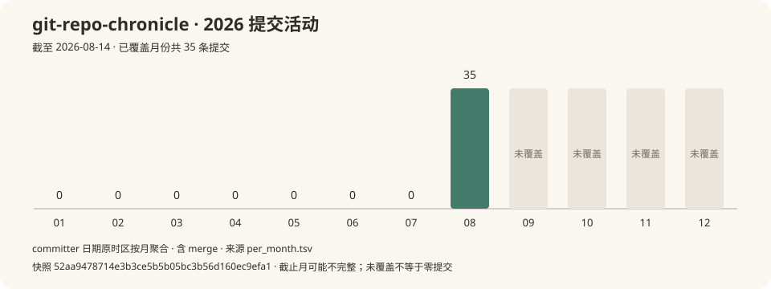

# Git Repo Chronicle 开发编年史

> 整理日期 2026-10-22
> 数据来源 固定截点 `52aa9478714e3b3ce5b5b05bc3b56d160ec9efa1` 的 35 条 Git 提交,含 merge;GitHub release、PR 与论坛资料未获取
> 核心结论 从导出历史、指导写作起步,项目很快补上 EPUB 与在线书输出,随后把写作质量要求写成检查清单。

## 三幕梗概

### 起因

2026 年 8 月 7 日,仓库的第一条提交把技能说明、结构模板和采集脚本一起放了进来。它要解决的事情已经写得具体,从 Git 提交出发,补上 release、issue 和论坛材料,写成一部按年展开、每条提交可追溯的项目历史。安装器负责把技能放进不同工具的目录,写作规则负责把零散记录接成文章。最初的交付物是 Markdown 长文,已有示例可以对照。[最初的仓库](https://github.com/tsonglew/git-repo-chronicle/tree/364ebe43a59d782d6321d67437572006395cb110)

### 转折

两天后,交付物开始走出 Markdown。`f843990` 加入标准库实现的 EPUB 转换脚本,同一天的 `b589328` 又增加在线书输出,让同一份源稿生成目录页和分章网页。项目此时要同时处理章节结构、图片引用与阅读呈现,出版规范也随之进入技能。文字写完只是其中一步,读者怎样打开它,已经落到了脚本里。[EPUB 实现](https://github.com/tsonglew/git-repo-chronicle/blob/f8439902218ce78591a3eb3d20946b341f126985/skills/git-repo-chronicle/scripts/md2epub.py)、[在线书实现](https://github.com/tsonglew/git-repo-chronicle/blob/b5893284e875cb6f25463c62a07ac1fad77766f6/skills/git-repo-chronicle/scripts/md2epub.py)

### 现状

到本次历史截点,写作工作流又多了一层明确的检查。8 月 10 日的 `b5bf19c` 将数字来源、真实哈希、数据速览、推断标注和缺失资料处理写成规则,并提供可直接填写的单章模板。这个短阶段留下的主线是采集、写作和出版逐步接起来,同时用规则减少成稿走样。现有记录能证明工具和规范的变化,还不能证明读者规模或社区评价;这些材料在本例中仍标为未获取。[当时的检查规则](https://github.com/tsonglew/git-repo-chronicle/blob/b5bf19ca8767c6792e08f8a1d3c230df7377d266/skills/git-repo-chronicle/SKILL.md)

## §0 项目是什么

Git Repo Chronicle 是一套供 AI 使用的项目历史写作技能。它把采集脚本、写作规范与出版工具装在同一目录,用户给出仓库后,按需形成 Markdown、EPUB 或在线书。此例只使用本仓库已经提交的材料,展示如何写一段短而可核查的开发史。

| 指标 | 数值 / 范围 |
|---|---|
| 历史范围 | 2026-08-07 至 2026-08-14,截至 `52aa947` |
| 提交总数 | 35,含 merge |
| 作者数 | 1,按原始邮箱去重 |
| 本地 tag 数 | 0,无版本号范围 |
| GitHub release / PR 数 | 未获取,不能由 tag 或提交消息推导 |
| 主要实现 | Markdown 规范、Shell 采集、Node 安装器、Python 出版工具 |

```text
2026 ███████████████████████████████████ 35
```

## §1 人物图鉴

| 作者 | 提交数 | 活跃期 | 可核查的贡献 |
|---|---|---|---|
| Tsonglew | 35 | 2026-08-07 至 2026-08-14 | 初始技能、采集与出版脚本、规范和示例的署名作者 |

### 贡献者指纹

本章只观察到一个 Git 作者身份,没有后续新作者进入。这个结果描述提交署名,不用于判断协作方式或项目外部的职务。

| 章节 | 主要贡献者 / 首次出现 | 路径与主线 | 代表提交 |
|---|---|---|---|
| §2 初创 | Tsonglew / 2026-08-07 | `SKILL.md` 与 `references/`,把写作流程和检查要求写入技能 | [最初规则 `364ebe4`](https://github.com/tsonglew/git-repo-chronicle/commit/364ebe43a59d782d6321d67437572006395cb110)、[检查清单 `b5bf19c`](https://github.com/tsonglew/git-repo-chronicle/commit/b5bf19ca8767c6792e08f8a1d3c230df7377d266) |
| §2 初创 | Tsonglew / 本章持续参与 | `scripts/md2epub.py`,接上 EPUB 与在线书输出 | [EPUB `f843990`](https://github.com/tsonglew/git-repo-chronicle/commit/f8439902218ce78591a3eb3d20946b341f126985)、[在线书 `b589328`](https://github.com/tsonglew/git-repo-chronicle/commit/b5893284e875cb6f25463c62a07ac1fad77766f6) |

## §2 2026 初创 · 从写作技能到出版工具(35 条)

一句话。第一版把历史资料变成文章,后续提交又给文章补上了电子书、网页和检查清单。

> 本章 35 条提交,1 位活跃作者,0 个 tag(无版本号范围),历史覆盖至 2026-08-14



图中数量来自 [月度统计](data/repository-per-month.tsv),含 merge,按提交者时间的原时区年月聚合。灰色月份为截点之后未覆盖的时间,不能读成停更。

最初的仓库已包含安装、数据采集与写作模板,之后的扩展也围绕这条流程展开。8 月 8 日的偏好配置允许调整语言、深度、结构和输出格式,写作者可以把同一套流程用于不同交付场景。[当时的配置](https://github.com/tsonglew/git-repo-chronicle/blob/543493312943f64fea1354f166697ed2271ba1af/skills/git-repo-chronicle/SKILL.md)

接下来的问题写在提交本身。出版功能增加后,规范开始处理 Markdown 怎样变成 EPUB 和网页;写作质量方面,`b5bf19c` 的提交正文明确提出让能力较弱的模型也能规范输出。它把容易遗漏的要求改成铁律、最小交付表和填空模板,为后续使用者留下了具体检查入口。[该提交及动机](https://github.com/tsonglew/git-repo-chronicle/commit/b5bf19ca8767c6792e08f8a1d3c230df7377d266)

### 事件批次

#### 批次 01,先接通采集与写作

- `364ebe4` **feat: git-repo-chronicle skill, project chronicle from git history**(Tsonglew)首次提交包含技能、结构模板、Git 历史导出与 GitHub 元数据采集脚本,把材料采集和成文步骤放进一套流程。[当时的树](https://github.com/tsonglew/git-repo-chronicle/tree/364ebe43a59d782d6321d67437572006395cb110)
- `5434933` **feat: user-configurable preferences, language, style, structure**(Tsonglew)增加用户偏好,允许调整语言、叙事重点与输出格式,为不同读者和交付目的保留选择。[当时的技能](https://github.com/tsonglew/git-repo-chronicle/blob/543493312943f64fea1354f166697ed2271ba1af/skills/git-repo-chronicle/SKILL.md)

#### 批次 02,让源稿成为电子书和网页

- `f843990` **feat: EPUB publishing as final output standard**(Tsonglew)新增 `md2epub.py`,用 Python 标准库生成 EPUB,把目录、封面和图片组织进电子书。[当时的实现](https://github.com/tsonglew/git-repo-chronicle/blob/f8439902218ce78591a3eb3d20946b341f126985/skills/git-repo-chronicle/scripts/md2epub.py)
- `b589328` **feat: online book site output alongside EPUB**(Tsonglew)为同一脚本增加 `--site`,输出目录页和分章网页;读者由此多了浏览器阅读入口。[当时的实现](https://github.com/tsonglew/git-repo-chronicle/blob/b5893284e875cb6f25463c62a07ac1fad77766f6/skills/git-repo-chronicle/scripts/md2epub.py)

#### 批次 03,把成稿要求落实到证据和检查

- `278a758` **feat: motivation chain, why matters more than what**(Tsonglew)采集 PR 正文并提取关闭 issue 的关联,让写作者有材料解释为何改动;正文取不到时保留降级流程。[当时的采集脚本](https://github.com/tsonglew/git-repo-chronicle/blob/278a758ba8d7c24d38f6a493239470d483aaee1f/skills/git-repo-chronicle/scripts/fetch_github_meta.sh)
- `b5bf19c` **docs: make skill rules explicit for weaker models**(Tsonglew)把哈希、数字来源、缺失数据标记和章节结构写成可逐项检查的规则,并补上单章模板。[当时的规则](https://github.com/tsonglew/git-repo-chronicle/blob/b5bf19ca8767c6792e08f8a1d3c230df7377d266/skills/git-repo-chronicle/SKILL.md)

### 本章之变

本章末尾,仓库已经能够支持采集、成文和出版几个环节,维护内容也从写作指导扩展到脚本与出版规范。采集不完整仍会限制能写出的结论,规则本身无法补出未取得的社区材料。主要贡献者与路径对应见 [人物图鉴](#1-人物图鉴);本章没有多年存量代码的比较问题,因此未生成代码存活附录。

### 本章关键词

`写作技能` `出版输出` `来源核对` `质量检查`

## §3 尾声

这段短历史中,输出形态的扩展可以沿着 `f843990` 和 `b589328` 直接核查,写作要求的收紧可以沿着 `b5bf19c` 核查。它说明项目维护同时发生在脚本和规范里。读者是否因此更容易完成一部编年史,需要另外的使用记录才能判断。

## 附录 A PR 时间线

未获取。此例没有采集 GitHub PR 元数据,不把提交消息中缺少 PR 编号解释成没有 PR。

## 数据方法论

本例截点固定为 `52aa9478714e3b3ce5b5b05bc3b56d160ec9efa1`,不包含该截点之后的功能。数字来自该截点执行 `dump_git_history.sh` 的输出,章节只精读上述代表提交。历史含 merge,按 `%cI` 提交者时间的原偏移年月分组;这不是每个提交进入默认分支的精确时间。作者按原始邮箱去重,未做身份合并,表格仅展示公开署名。

在本仓库中可用以下只读命令复核截点、作者和文件。每条命令都指定固定 SHA,不会受后来提交影响。

```bash
git rev-list --count 52aa9478714e3b3ce5b5b05bc3b56d160ec9efa1
git shortlog -sne 52aa9478714e3b3ce5b5b05bc3b56d160ec9efa1
git log --format='%H %cI %an' 52aa9478714e3b3ce5b5b05bc3b56d160ec9efa1
git show b5893284e875cb6f25463c62a07ac1fad77766f6 -- skills/git-repo-chronicle/scripts/md2epub.py
```

GitHub release、PR、论坛、RSS 与新闻资料未获取,原因是本例限定为本地 Git 材料演示,未进行外部采集;无法据此评价社区态度或覆盖率。本地 tag 数记录的是整理时所见状态,tag 引用可以变化,不能当作历史 release 总数。代码存活附录未生成,原因是本例覆盖期短且主题是工作流扩展。无未经标注的身份、动机或社区反应推断。
