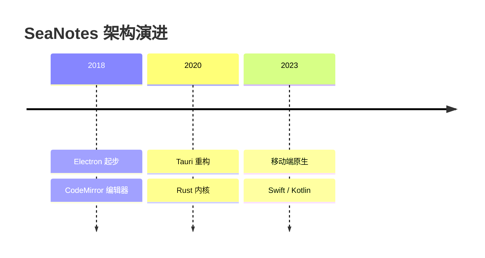
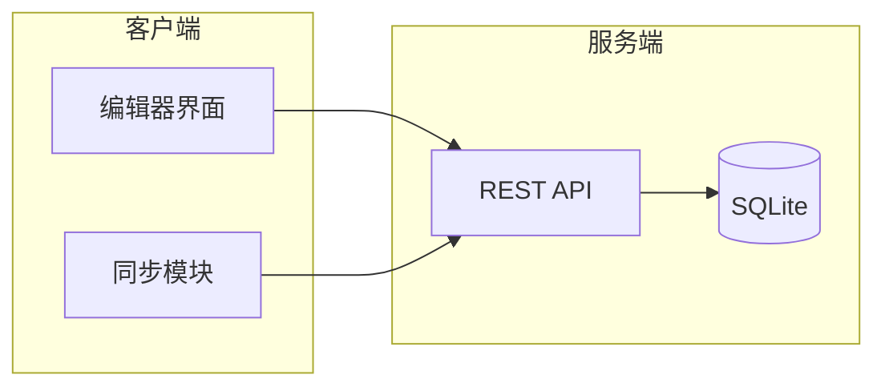
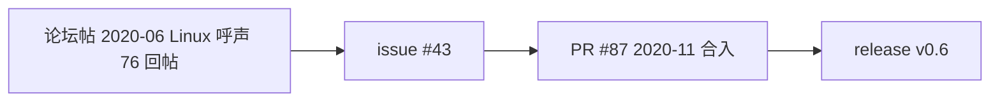
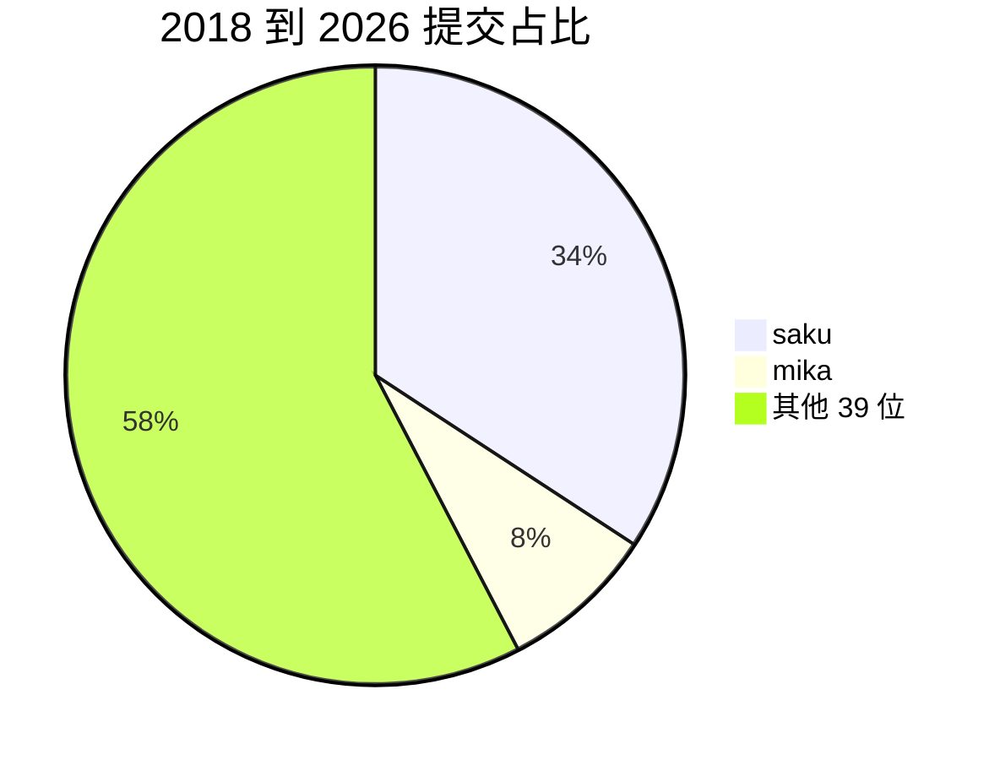

> 配图规范。默认 Mermaid 嵌入 Markdown,GitHub 原生渲染;图类型与位置、写法示例、独立图片导出与校验。图从数据来,不先画图再凑数据。

# 编年史配图手册

编年史正文按年叙事,配图把"演进"本身画出来。本文定义配什么图、画在哪里、用什么语法。

## 配图原则

1. 图从数据来。图上每个数字、节点、箭头,都能在正文或数据源里找到出处。先有数据和叙事,再决定画什么,不许先画图再凑数据。
2. 图服务于叙事。架构与流程图全篇通常五到八张;章首活动图按章节另计,与装饰插图用途不同。同一信息只画一次。
3. 默认 Mermaid,直接嵌进 Markdown 代码块,GitHub 打开即渲染,零依赖。需要独立图片文件时,用 mermaid-cli 或 Graphviz 导出。

## 图类型与位置

| 图 | 画什么 | 放哪 |
|---|---|---|
| 月度柱状 / 热力图 | 一年内提交活动的忙闲节奏 | 推荐每个年度章节的数据速览之后 |
| timeline | 生命周期关键节点、架构演进 | §0 项目全景,架构转型章节开头 |
| flowchart | 系统架构、模块关系、互文流程 | 里程碑年份的架构快照,§11 互文时刻 |
| pie | 作者贡献占比、语言占比 | §1 人物图鉴(可选) |
| xychart / ASCII | 年度提交量、论坛热度对照 | §0 全景数字,§11 热度对照 |
| sequenceDiagram | 发布流程、协作时序 | 少用,仅当流程本身是叙事重点 |

具体位置。

- §0 项目是什么。放一张 timeline,把生命周期关键节点连起来(诞生、架构转型、发布、停更、复活)。
- 架构转型年份。放迁移前后对比,画两张 flowchart 或一张"前到后"的图,节点用当时的真实组件名。
- 里程碑年份。放当前架构快照,服务端、客户端、数据层各自成块,块上注明 commit 哈希。
- §11 论坛回声。互文时刻画成 flowchart,从论坛帖一路连到落地提交。

## 每年章首节奏图

**推荐每个年度章节有一张活动图**，放在一句话与数据速览之后、正文之前。读者先看月份的忙闲，再读事件。月度章节可用日或周聚合；章节合并多个月时，图的范围也要相同。柱状图、热力图或现成工具导出图均可，不必实现新的可视化引擎。活动量不能单独证明危机、技术债或作者的工作时长。

- 数据来自同一快照的 `git log` 聚合；默认用 `dump_git_history.sh` 的 `per_month.tsv`，三列为月份、提交数、作者数，无表头。使用 committer ISO 日期的原时区年月，不把 author 日期或 PR 的 `mergedAt` 混入同一图。默认含 merge；用了 `--first-parent` 必须在图注声明。
- 推荐 SVG `viewBox="0 0 960 360"`，宽度随正文缩放，字号至少 12px；PNG 导出用 1920×720。图注写年份、数据文件、截止日期、固定 commit 和统计口径。保留文本说明或数据表，以便图片不可见时仍能读数。
- **完整覆盖范围内**没有提交的月份补零；尚未采集或超出截点的月份标「未覆盖」，不能补零。增量范围的 TSV 只代表增量，不能直接画成完整年度图；先和已归档数据按哈希去重重算，或明确只画新增区间。
- 图片生成失败时，保留月度数据表，并写「本章活动图未生成，原因为……；月度统计见……」。连数据也未获取时写明原因与范围，不用装饰插图代替统计图。

标准库脚本提供简单的 SVG 柱状图，无需安装绘图库。下面的相对路径以技能目录为当前目录；`--through` 是数据覆盖截止日，不是运行命令当天。输入必须覆盖所画年份从年初到截止日的全部历史。

```bash
python3 scripts/render_activity.py /tmp/repo-meta/per_month.tsv docs/notes/images/activity-2026.svg \
  --year 2026 --through 2026-08-14 --revision 52aa947 --title git-repo-chronicle
# first-parent 数据加 --basis 'committer 日期原时区按月聚合 · first-parent · 来源 per_month.tsv'
```

真实样章与可核查输入见 [仓库自身编年史](../examples/repository-chronicle.md)、[月度 TSV](../examples/data/repository-per-month.tsv) 和 [活动图 SVG](../examples/images/repository-activity-2026.svg)。该图固定在 `52aa9478714e3b3ce5b5b05bc3b56d160ec9efa1`，含 merge 的 35 条提交均在 2026 年 8 月；9–12 月标未覆盖。用下面的命令可重新生成相同输入：

```bash
git log 52aa9478714e3b3ce5b5b05bc3b56d160ec9efa1 --format='%cI%x09%ae' \
  | awk -F'\t' '{m=substr($1,1,7); n[m]++; if (!seen[m FS $2]++) a[m]++} END {for (m in n) print m "\t" n[m] "\t" a[m]}' \
  | sort > examples/data/repository-per-month.tsv
```

## Mermaid 写法示例

### timeline(架构演进)



### flowchart(架构快照)



### flowchart(互文时刻)



### pie(作者贡献)



## 语法注意

- 节点文字别用括号、引号、分号等特殊字符,要用就给文字加引号。
- flowchart 方向。LR 适合演进流程,TD 适合层级架构。
- subgraph 给组件分组,避免图太散。
- 数字必须与 `per_year.tsv`、`per_author.tsv` 或正文一致。
- GitHub 对 Mermaid 的支持够用,复杂图先本地验证再交。

## 导出独立图片

需要 PNG/SVG 文件时,用下面的命令。

```bash
# mermaid-cli(需 Node)
npx -y @mermaid-js/mermaid-cli -i arch.mmd -o arch.png

# Graphviz
dot -Tsvg arch.dot -o arch.svg
```

图片放进 `docs/notes/images/`,正文用相对路径引用。图里的中文要确认渲染字体支持。

## 校验

1. 每张图对照正文数据,数字一致。
2. 每条连线问一句,这个关系在正文哪句话里。答不上来就删边。
3. 图的叙事贡献。删掉这张图,正文少了什么。没有就删图。
4. Mermaid 语法正确,能在 GitHub 渲染。
